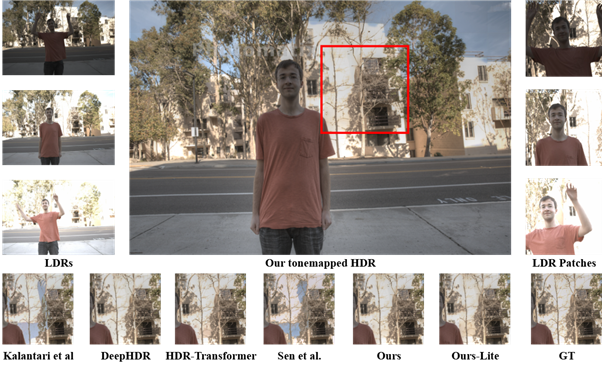

<h1 align="center">EfficienT-HDR</h1>

<p align="center">
  <strong>An Efficient Transformer-Based Framework via Multi-Exposure Fusion for HDR Reconstruction</strong>
</p>
<p align="center">Yu-Shen Huang · Tzu-Han Chen · Cheng-Yen Hsiao · Shaou-Gang Miaou</p>
<p align="center">
  <a href="https://arxiv.org/abs/2509.19779">Paper</a> ·
  <a href="#models">Models</a> ·
  <a href="#paper-results">Paper results</a> ·
  <a href="#quick-start">Quick start</a> ·
  <a href="#citation">Citation</a>
</p>

EfficienT-HDR merges three differently exposed LDR images into a single HDR reconstruction. It uses YCbCr input processing and Intersection-Aware Adaptive Fusion (IAAF) to reduce ghosting in dynamic scenes. Inverted Residual Embedding, Dynamic Tanh, and Enhanced Multi-Scale Dilated Convolution reduce the cost of Transformer-based reconstruction. [Paper, Sections III–IV](https://arxiv.org/abs/2509.19779)


*Figure 2 from the paper. The normally exposed frame serves as the reference for fusion.*

## Models

| Variant | CLI | Implementation | Fusion |
| --- | --- | --- | --- |
| EfficienT-HDR | `--model main` | [`efficient_hdr.py`](models/efficient_hdr.py) | Combines aligned and original exposure features in `5C` channels |
| EfficienT-HDR-Lite | `--model lite` | [`efficient_hdr_lite.py`](models/efficient_hdr_lite.py) | Combines aligned exposure features with the reference in `3C` channels |

Both scripts default to `lite`. Here, `C` is the number of channels in the features extracted from one exposure. [Paper, Section IV-F](https://arxiv.org/abs/2509.19779)

<details>
<summary>View the Lite architecture</summary>


*Figure 9 from the paper. The red box marks the streamlined fusion stage.*

</details>

## Paper results

Results on the Kalantari and Ramamoorthi dataset, as reported in Tables I–III. CPU latency uses ONNX on an Intel Core i7-11800H. Both latency columns are per patch. [Paper](https://arxiv.org/abs/2509.19779)

| Model | PSNR-μ (dB) ↑ | HDR-VDP-2 ↑ | FLOPs (G) ↓ | CPU (ms) ↓ | Jetson Xavier NX (ms) ↓ |
| --- | ---: | ---: | ---: | ---: | ---: |
| HDR-Transformer | **42.719** | 64.63 | 21.61 | 662.68 | 2151.68 |
| EfficienT-HDR | 41.487 | **65.09** | 7.04 | 125.81 | 857.55 |
| EfficienT-HDR-Lite | 41.060 | 64.88 | **5.98** | **116.06** | **800.47** |

<p align="center">
  
</p>

*Figure 7 from the paper. The marked crop is shown across methods to compare ghosting and fine detail.*

## Quick start

### 1. Install dependencies

Use Python 3.9. The local setup uses PyTorch 2.1.0 and Torchvision 0.16.0 with CUDA 12.1. Install the matching PyTorch build for your platform before the remaining dependencies if you use a different build.

```sh
python -m pip install -r requirements.txt
```

### 2. Prepare the dataset

Download the training and test sets from the [Kalantari and Ramamoorthi dataset page](https://cseweb.ucsd.edu/~viscomp/projects/SIG17HDR/). Each scene directory contains three `.tif` exposures, `exposure.txt`, and `HDRImg.hdr`.

```text
data/
├── Training/<scene>/
└── Test/
    ├── EXTRA/<scene>/
    └── PAPER/<scene>/
```

From the repository root, generate the 128 × 128 training patches with stride 64.

```sh
python -m dataset.gen_crop_data --data_root ./data
```

### 3. Train

```sh
python train.py --model main --test_split EXTRA --logdir ./checkpoints/main
python train.py --model lite --test_split EXTRA --logdir ./checkpoints/lite
```

The default objective in [`models/loss.py`](models/loss.py) adds μ-law L1 reconstruction loss to a VGG16 feature loss weighted by `0.01`. Both terms use μ-law tone mapping with `μ = 5000`. For L1 reconstruction alone, use `--loss_func 0`.

Use `wandb login` to sync training runs, or set `WANDB_MODE=offline` for local logging. To continue a run, pass `--resume PATH` with its `val_latest_checkpoint.pth` and select the same model variant.

### 4. Evaluate

```sh
python test.py --model main --test_split EXTRA --pretrained_model ./checkpoints/main/best_checkpoint.pth --save_dir ./results/main
python test.py --model lite --test_split EXTRA --pretrained_model ./checkpoints/lite/best_checkpoint.pth --save_dir ./results/lite
```

The script reports PSNR and SSIM in linear and μ-law domains. Select a folder below `data/Test` with `--test_split`, such as `Real` or `PAPER`. If omitted, the loader tries `Te`, `Real`, then `EXTRA`, and otherwise checks for scenes directly under `data/Test`. Use `--no_cuda` for CPU evaluation or `--no-save_results` to print metrics without writing HDR images.

Datasets, weights, and generated outputs live locally. Prior local checkpoint paths are `checkpoints/V11_1/best_checkpoint.pth` for `main` and `checkpoints/V10-3/best_checkpoint.pth` for `lite`.

## Citation

```bibtex
@article{huang2025efficienthdr,
  title={EfficienT-HDR: An Efficient Transformer-Based Framework via Multi-Exposure Fusion for HDR Reconstruction},
  author={Huang, Yu-Shen and Chen, Tzu-Han and Hsiao, Cheng-Yen and Miaou, Shaou-Gang},
  journal={arXiv preprint arXiv:2509.19779},
  year={2025}
}
```

This implementation builds on the Context-Aware Vision Transformer from [HDR-Transformer](https://github.com/ljzycmd/HDR-Transformer) by Zhen Liu, Yinglong Wang, Bing Zeng, and Shuaicheng Liu (ECCV 2022).
